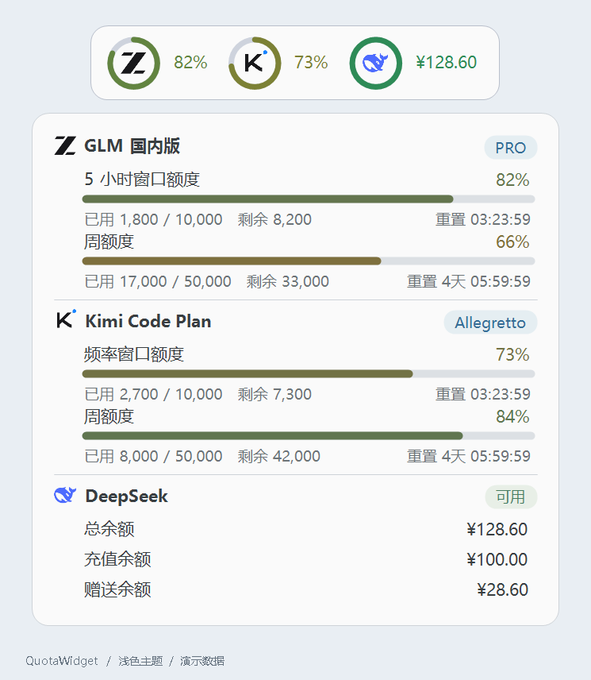
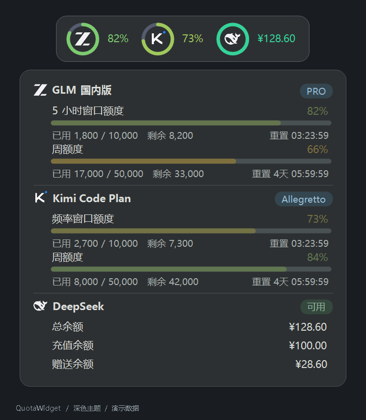
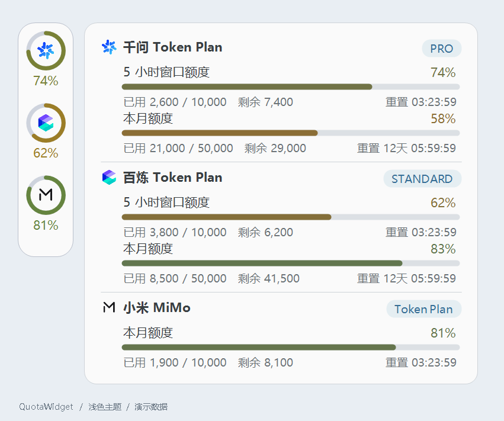
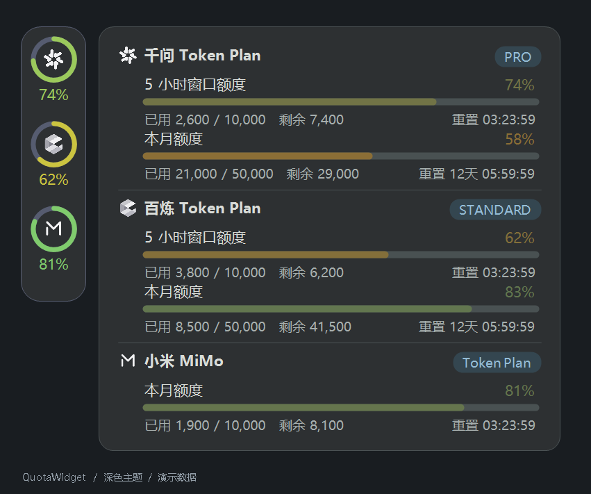
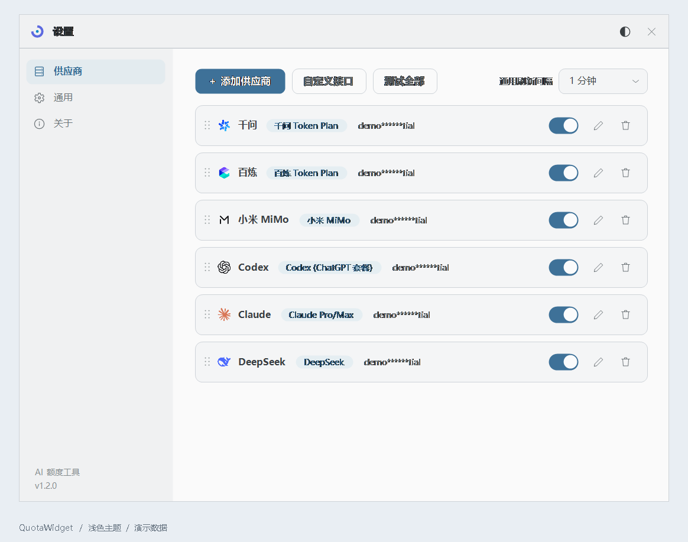
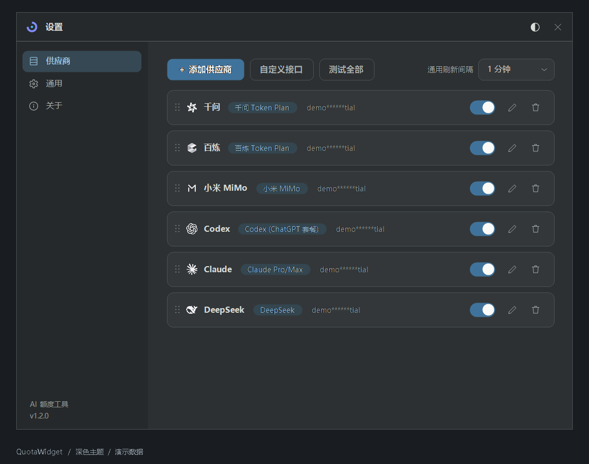
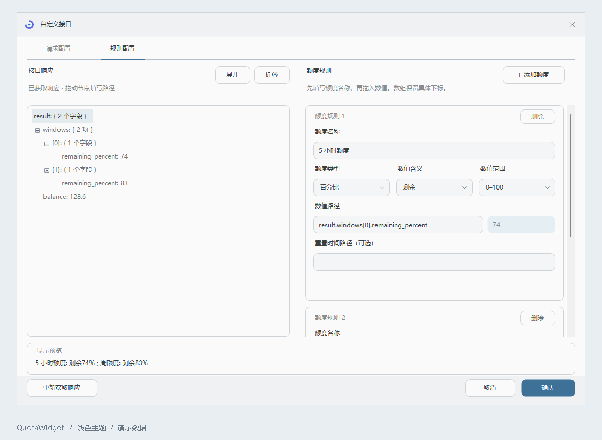
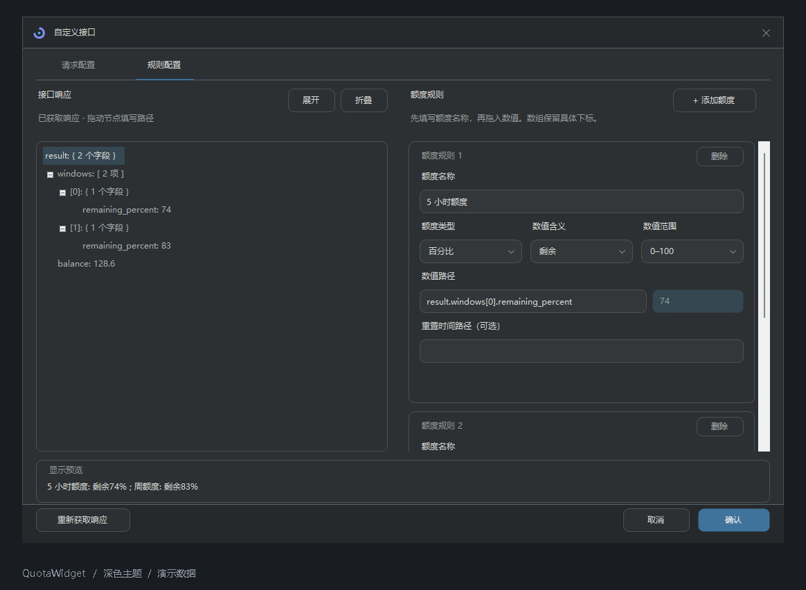

# QuotaWidget · AI 额度工具

在桌面集中查看 AI 套餐额度与账户余额。 
贴边收起，悬停展开，支持深浅主题与自定义接口。 
使用 C# 与 WinForms 开发的 Windows 原生应用，免安装运行。

  
  
  
  

  <a href="docs/getting-started.md">快速开始</a> ·
  <a href="docs/providers/README.md">供应商配置</a> ·
  <a href="docs/custom-api.md">自定义接口</a> ·
  <a href="docs/faq.md">常见问题</a> ·
  <a href="docs/privacy.md">数据与隐私</a> ·
  <a href="docs/development.md">参与开发</a>

## 支持的供应商

[GLM（国内 / 国际）](docs/providers/glm.md) · [MiniMax（国内 / 国际）](docs/providers/minimax.md) · [Kimi Code Plan](docs/providers/kimi.md) · [DeepSeek](docs/providers/deepseek.md)

[Claude Pro / Max](docs/providers/claude.md) · [Codex（ChatGPT 套餐）](docs/providers/codex.md) · [小米 MiMo](docs/providers/mimo.md) · [千问](docs/providers/qwen.md) · [百炼](docs/providers/bailian.md) · [自定义接口](docs/custom-api.md)

## 界面预览
### 悬浮窗与额度详情

| 浅色主题 | 深色主题 |
| --- | --- |
|  |  |

### 侧边吸附

| 浅色主题 | 深色主题 |
| --- | --- |
|  |  |

### 供应商设置

| 浅色主题 | 深色主题 |
| --- | --- |
|  |  |

### 自定义接口

| 浅色主题 | 深色主题 |
| --- | --- |
|  |  |

---

[MIT 许可证](LICENSE) · [问题反馈](https://github.com/DashingMonkey/quota-widget/issues) · [品牌图标说明](assets/brands/README.md)
