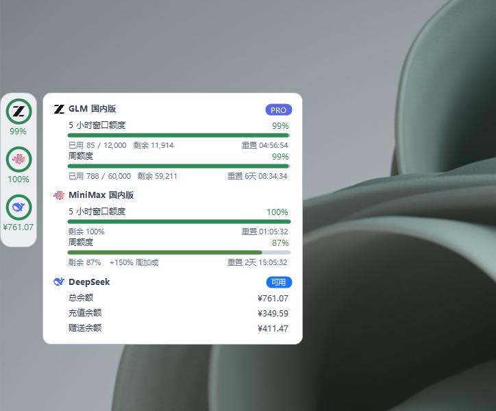

# QuotaWidget - AI 额度工具

一个轻量级的 Windows 桌面悬浮窗，实时监控多个 AI 服务商的额度使用情况。纯 C# WinForms 单文件实现，零依赖，双击即用。


条形灵动岛可拖到屏幕**左右两侧**吸附为竖向条（每服务商：环形进度 + 百分比/余额两行，跨屏拖动各自独立判定）：



悬浮窗还有**条形灵动岛**排列（设置 → 通用 → 排列）：内容自适应宽的圆角胶囊贴顶显示，鼠标离开自动收起（不占用桌面空间），移入滑出展开，可拖拽定位与跨屏。

鼠标悬停自动展开详情面板，显示各额度池（5 小时窗口 / 周额度 / 余额明细）及重置倒计时。

## 功能特性

- **多服务商监控**：GLM、MiniMax、Kimi Code Plan、DeepSeek、Claude Pro/Max、Codex (ChatGPT 套餐)，以及自定义 GET / POST 接口
- **图标 / 名称两种展示**：悬浮窗默认显示品牌图标 + 外圈环形额度进度 + 百分比；图标浅色主题用品牌彩色、深色主题自动切换为白色，也可切换为自定义名称展示
- **两种排列**：条形灵动岛 / 矩形卡片，支持“始终置顶”
- **独立刷新**：供应商页“添加供应商”同一行右侧设置通用间隔（默认 60 秒）；添加 / 编辑每个供应商时可通过下拉框选择独立间隔，默认“跟随通用”。修改间隔并保存后保留已有额度，从保存时重新计满新间隔再查询；通用间隔只影响跟随通用的接口，普通保存不会强制刷新全部供应商。双击悬浮窗立即刷新，接口要求的冷却时间仍然生效
- **自定义接口**：GET / POST 下拉选择、自定义请求头与请求体、JSON 节点拖拽、多套独立额度规则；支持百分比（已用 / 剩余、0–100 / 0–1）、余额与单位倍率、已用量 / 总量、重置时间、图标 / 名称及查询预览
- **托盘定位**：单击托盘，已开启的吸附悬浮窗展开 2 秒；鼠标移入后按正常悬停操作，未移入则自动缩回原吸附边。连续单击会重新计时，普通悬浮窗保持显示
- **悬浮窗开关**：右键悬浮窗或托盘，根据状态显示“开启悬浮窗”/“关闭悬浮窗”；关闭后继续后台刷新与托盘摘要，并记住关闭状态。托盘单击、双击均不切换开关
- **菜单保持展开**：吸附悬浮窗的右键菜单打开期间暂停自动收缩；选择菜单项或点击外部关闭菜单后恢复。鼠标仍在悬浮窗上时保持展开，已经离开时延迟收回
- **圆角悬停**：展开时按固定区域判断鼠标位置，移到透明圆角不会反复收缩、展开。鼠标离开悬浮窗和详情区域后统一等待约 0.5 秒再收起，重新移入则取消计时；重复移出事件不会延长等待，托盘定位仍保持 2 秒。
- **连接测试**：设置页一键测试已启用供应商的连接状态与额度明细
- **供应商开关**：每行编辑按钮左侧可开启/停用，点击“保存”后生效。停用时保留配置，但跳过自动查询、测试全部和悬浮窗/详情/托盘摘要展示；全部停用时显示“已暂停”，重新开启即可恢复
- **可定制**：浅色/深色主题、窗口透明度、位置记忆、开机自启

## 支持的服务商

| 服务商 | 区域 | 接口 | 展示内容 |
|--------|------|------|----------|
| GLM (智谱) | 国内 / 国际 | `open.bigmodel.cn` / `api.z.ai` | 5 小时窗口额度、周额度、会员等级 |
| MiniMax | 国内 / 国际 | `minimaxi.com` / `minimax.io` | 5 小时窗口额度、周额度、周加成 |
| Kimi (Code Plan) | - | `api.kimi.com` | 频率窗口额度、周额度、会员等级 |
| DeepSeek | - | `api.deepseek.com` | 账户余额（总/充值/赠送） |
| Claude Pro/Max | - | `api.anthropic.com` | 5 小时窗口已用 %、周已用 %、重置时间 |
| Codex (ChatGPT 套餐) | - | `chatgpt.com` | 5 小时窗口已用 %、周已用 %、重置时间、套餐档位 |
| 自定义接口 | - | 用户填写的 HTTP / HTTPS JSON 地址 | 百分比、余额或已用量 / 总量，多套规则、重置时间 |

### 自定义接口

设置 → 供应商 → 点击“添加供应商”右侧的 **自定义接口**。面板分为“请求配置 / 规则配置”两个标签页。

- **请求配置**：填写接口名称和完整 JSON 地址，通过下拉框选择 GET / POST。请求头默认 `Authorization: Bearer XXXXXXXXXX`，可修改为 `x-management-key: 你的密钥` 等认证方式；每行一个请求头，无需认证时清空。POST 可填写请求体，默认使用 `application/json; charset=utf-8`，也可通过 `Content-Type` 修改。请求头和请求体使用 Windows DPAPI 加密保存。
- **显示与刷新**：请求页底部左侧选择“图标 / 名称”，右侧选择刷新间隔，默认“跟随通用”。下方按选择显示图标下拉框或显示名称输入框；名称默认跟随接口名称，手动修改后独立保存，留空保存则恢复跟随。
- **测试与配置**：只需填好请求即可点击，无须先填写额度规则。点击后进入规则配置页，在左半边以可折叠的 JSON 树显示响应，默认展开；超大响应分批展开。敏感字段仅显示隐藏提示。
- **拖拽取值**：先填写右侧规则的额度名称，再将左侧 JSON 节点拖入数值、总量或重置时间字段。路径可以手动编辑；例如 `result.accounts[0].windows[1].remaining_percent`。数组保留拖动时的 `[0]`、`[1]` 等具体下标，不自动遍历。路径右侧以灰色显示当前节点值；字段不存在时隐藏该值区域。`result` 代表响应根；不执行 JavaScript。
- **多套规则**：使用“添加额度”增加整套配置，至少保留一套，每套先填写名称，例如“5小时额度”“周额度”“余额”。每套独立选择百分比（已用 / 剩余、0–100 / 0–1）、余额（单位、倍率）或已用量 / 总量；重置时间可选，支持 ISO 时间与 Unix 秒 / 毫秒时间戳。
- **缺值隐藏**：某套规则的数值或总量取不到时（例如数组变短、字段缺失、返回 null 或空字符串），仅隐藏这一套额度，不报错，也不影响其他规则；配置会保留，后续刷新取到值后自动恢复显示。规则预览与保存同样处理，全部缺值也可保存。可选的重置时间缺失时仍展示额度。
- **实时预览**：底部固定按 `5小时额度: 剩余49% ; 周额度: 剩余82%` 或 `余额: $12.30` 显示有效规则的结果。无效规则在对应卡片内提示。修改规则、拖动节点仅使用当前响应在本地计算，不发起网络请求；“重新获取响应”才会再次查询。改变请求地址、方法、头或体后清除旧响应，避免拿错数据。
- **保存与冷却**：点击“确认”返回设置，再点击“保存”生效。已完成测试的规则复用本次响应，到刷新间隔后再查询。接口的 `next_allowed_in`、HTTP `Retry-After` 和 429 冷却仍然生效。自定义认证头不随重定向发送，请填写最终接口地址。

例如接口返回：

```json
{
  "next_allowed_in": 120,
  "accounts": [{
    "windows": [
      { "remaining_percent": 49 },
      { "remaining_percent": 82 }
    ]
  }]
}
```

先添加“5小时额度”并拖入 `result.accounts[0].windows[0].remaining_percent`；再添加“周额度”并拖入 `result.accounts[0].windows[1].remaining_percent`。两套都选择百分比、剩余、0–100，即可看到整行预览。

### Claude / Codex 说明

两家订阅套餐均无公开的余额查询 API，本工具调用的是**官方 CLI 自身在用的用量接口**（未公开文档，接口可能随版本变化）：

- **Claude**：`GET api.anthropic.com/api/oauth/usage`（Claude Code 同款）。添加供应商时 API Key **可留空**，自动读取本机 `%USERPROFILE%\.claude\.credentials.json`（Claude Code 登录后生成并自动刷新）；也可手动粘贴访问令牌（`sk-ant-oat01-...`）。该接口按账户限速，悬浮窗会自动将轮询间隔限制在约 180 秒。若提示凭证过期，运行一次 `claude` 重新登录即可。
- **Codex**：`GET chatgpt.com/backend-api/wham/usage`（Codex CLI 同款）。API Key **可留空**，自动读取本机 `%USERPROFILE%\.codex\auth.json`（Codex 登录 ChatGPT 套餐后生成）；需为 ChatGPT 套餐登录而非 API Key 模式。

## 快速开始

前提：Windows 自带 .NET Framework（无需安装 Visual Studio）。

1. 双击 `build.bat`，生成 `QuotaWidget.exe`
2. 运行 `QuotaWidget.exe`，首次启动在主屏顶部居中显示条形灵动岛
3. 右键悬浮窗或托盘图标 → **设置…** → **+ 添加**，选择服务商、填入 API Key
4. 鼠标悬停悬浮窗展开详情面板，双击立即刷新
5. 找不到吸附位置时单击托盘定位；需要开启或关闭悬浮窗时使用右键菜单

旧版置顶栏模式已移除，升级后自动使用悬浮窗，并保留原悬浮窗位置、排列和供应商配置；旧置顶栏异常退出留下的工作区预留会在启动时清理。

> ⚠ API Key 以 Windows DPAPI（当前用户）加密存储在 `%LOCALAPPDATA%\QuotaWidget\config.json`（可在 **设置 → 关于 → 打开配置目录** 一键定位），可防文件被扫描/拷走；密文绑定本机与当前 Windows 账户，更换电脑或账户后需重新填写。请勿分享该文件。旧版本放在 exe 同目录的 `config.json` 会在升级后首次启动时自动迁移过去。

## 开发说明

- 单文件源码 `QuotaWidget.cs`，`build.bat` 调用系统自带 csc.exe 编译，零第三方依赖
- `tools/svg2png.cs`：品牌图标构建工具（SVG path → 透明底 PNG，含圆弧/贝塞尔解析），转换产物以 base64 内嵌于源码
- 运行 `powershell -File tests\Run-BehaviorTests.ps1` 检查托盘定位计时、悬停接管、供应商开关、独立刷新、旧配置兼容和自定义接口。测试使用内存配置及本地 TCP 假接口，验证请求头、限速、重定向、数值转换和多账号映射；不读取真实凭证或请求远端额度接口。测试会短暂显示窗体，渲染图输出到 `obj\behavior-tests\`

## License

MIT
