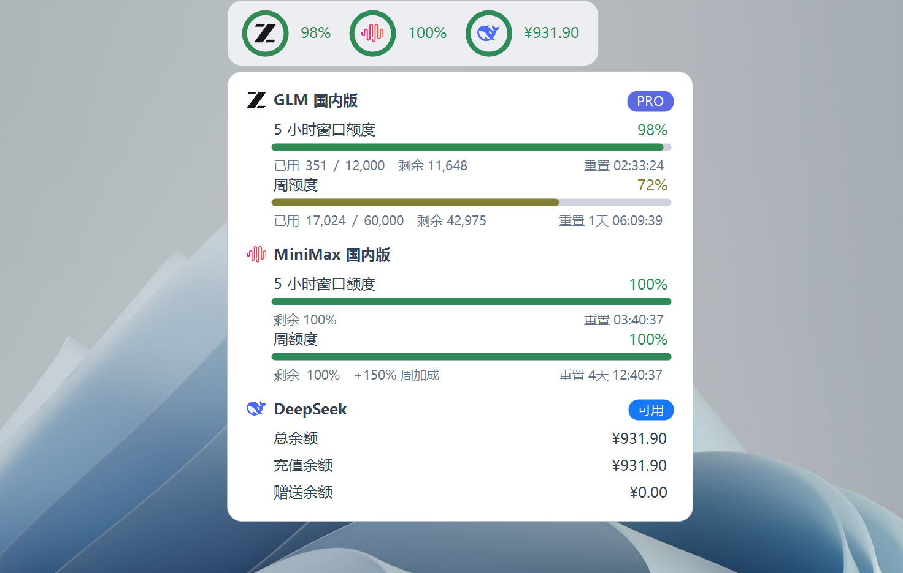
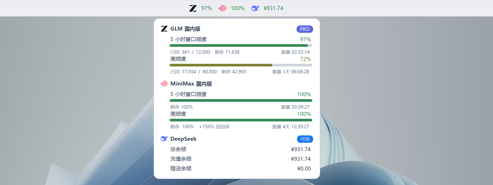

# QuotaWidget - AI 额度工具

一个轻量级的 Windows 桌面悬浮窗，实时监控多个 AI 服务商的额度使用情况。纯 C# WinForms 单文件实现，零依赖，双击即用。

条形灵动岛可拖到屏幕**左右两侧**吸附为竖向条（每服务商：环形进度 + 百分比/余额两行，跨屏拖动各自独立判定）。另有置顶栏模式，全宽贴屏幕顶边常驻显示（可切换显示器）：

悬浮窗还有**条形灵动岛**排列（设置 → 通用 → 排列）：内容自适应宽的圆角胶囊贴顶显示，鼠标离开自动收起（不占用桌面空间），移入滑出展开，可拖拽定位与跨屏。

鼠标悬停自动展开详情面板，显示各额度池（5 小时窗口 / 周额度 / 余额明细）及重置倒计时。

## 功能特性

- **多服务商监控**：GLM、MiniMax、Kimi Code Plan、DeepSeek、Claude Pro/Max、Codex (ChatGPT 套餐)
- **图标 / 名称两种展示**：悬浮窗与置顶栏默认显示品牌图标 + 外圈环形额度进度 + 百分比；图标浅色主题用品牌彩色、深色主题自动切换为白色，也可切换为自定义名称展示
- **双显示模式**：桌面悬浮窗（矩形卡片 / 条形灵动岛）/ 置顶栏
- **实时刷新**：定时轮询（默认 60 秒），双击悬浮窗立即刷新
- **托盘图标**：悬停显示各服务商剩余额度摘要
- **连接测试**：设置页一键测试所有供应商的连接状态与额度明细
- **可定制**：浅色/深色主题、窗口透明度、位置记忆、开机自启

## 支持的服务商

| 服务商 | 区域 | 接口 | 展示内容 |
|--------|------|------|----------|
| GLM (智谱) | 国内 / 国际 | `open.bigmodel.cn` / `api.z.ai` | 5 小时窗口额度、周额度、会员等级 |
| MiniMax | 国内 / 国际 | `minimaxi.com` / `minimax.io` | 5 小时窗口额度、周额度、周加成 |
| Kimi (Code Plan) | - | `api.kimi.com` | 频率窗口额度、周额度、会员等级 |
| DeepSeek | - | `api.deepseek.com` | 账户余额（总/充值/赠送） |
| Claude Pro/Max | - | `api.anthropic.com` | 5 小时窗口已用 %、周已用 %、重置时间 |
| Codex (ChatGPT 套餐) | - | `chatgpt.com` | 5 小时窗口已用 %、周已用 %、重置时间、套餐档位 |

### Claude / Codex 说明

两家订阅套餐均无公开的余额查询 API，本工具调用的是**官方 CLI 自身在用的用量接口**（未公开文档，接口可能随版本变化）：

- **Claude**：`GET api.anthropic.com/api/oauth/usage`（Claude Code 同款）。添加供应商时 API Key **可留空**，自动读取本机 `%USERPROFILE%\.claude\.credentials.json`（Claude Code 登录后生成并自动刷新）；也可手动粘贴访问令牌（`sk-ant-oat01-...`）。该接口按账户限速，悬浮窗会自动将轮询间隔限制在约 180 秒。若提示凭证过期，运行一次 `claude` 重新登录即可。
- **Codex**：`GET chatgpt.com/backend-api/wham/usage`（Codex CLI 同款）。API Key **可留空**，自动读取本机 `%USERPROFILE%\.codex\auth.json`（Codex 登录 ChatGPT 套餐后生成）；需为 ChatGPT 套餐登录而非 API Key 模式。

## 快速开始

前提：Windows 自带 .NET Framework（无需安装 Visual Studio）。

1. 双击 `build.bat`，生成 `QuotaWidget.exe`
2. 运行 `QuotaWidget.exe`，首次启动在屏幕右上角显示悬浮窗
3. 右键悬浮窗或托盘图标 → **设置…** → **+ 添加**，选择服务商、填入 API Key
4. 鼠标悬停悬浮窗展开详情面板，双击立即刷新

> ⚠ API Key 以 Windows DPAPI（当前用户）加密存储在 `%LOCALAPPDATA%\QuotaWidget\config.json`（可在 **设置 → 关于 → 打开配置目录** 一键定位），可防文件被扫描/拷走；密文绑定本机与当前 Windows 账户，更换电脑或账户后需重新填写。请勿分享该文件。旧版本放在 exe 同目录的 `config.json` 会在升级后首次启动时自动迁移过去。

## 开发说明

- 单文件源码 `QuotaWidget.cs`，`build.bat` 调用系统自带 csc.exe 编译，零第三方依赖
- `tools/svg2png.cs`：品牌图标构建工具（SVG path → 透明底 PNG，含圆弧/贝塞尔解析），转换产物以 base64 内嵌于源码

## License

MIT
