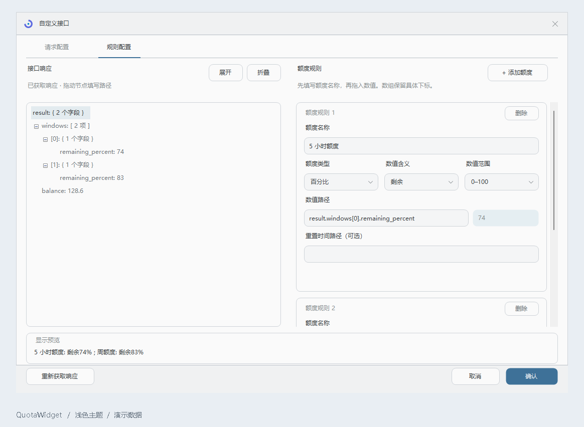
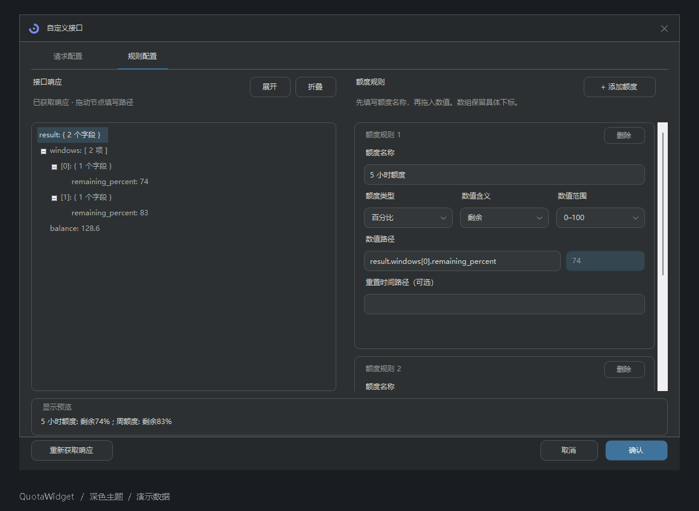

# 自定义接口

[返回首页](../README.md) · [文档目录](README.md)

在 **设置 → 供应商 → 自定义接口** 中，将返回 JSON 的 HTTP / HTTPS 接口接入悬浮窗。

1. **配置请求**：填写名称、完整地址与 GET / POST 方法。请求头每行一项；POST 可填写请求体，默认使用 JSON 格式。
2. **获取响应**：点击 **测试与配置**，左侧显示可折叠的 JSON 树。
3. **添加额度**：在右侧为规则命名，将 JSON 节点拖入数值、总量或重置时间字段，选择对应的额度类型。
4. **预览并保存**：确认底部预览正确，选择图标或显示名称、刷新间隔，点击 **确认**。

| 额度类型 | 配置方式 |
| --- | --- |
| 百分比 | 选择「已用 / 剩余」与「0–100 / 0–1」 |
| 余额 | 设置金额字段、单位与换算倍率 |
| 已用量 / 总量 | 分别指定已用量和总量字段 |
| 重置时间（可选） | 支持 ISO 时间、Unix 秒或毫秒时间戳 |

图标选择包含 MiMo、千问、百炼等全部内置品牌，选择框、下拉列表与悬浮窗均随明暗主题切换图标。

<details>
<summary><strong>示例：一个接口展示两组额度和余额</strong></summary>

假设接口返回：

```json
{
  "windows": [
    { "remaining_percent": 49 },
    { "remaining_percent": 82 }
  ],
  "balance": 12.3
}
```

添加以下三组规则即可：

| 额度名称 | 数值路径 | 类型与选项 | 预览 |
| --- | --- | --- | --- |
| 5 小时额度 | `result.windows[0].remaining_percent` | 百分比 · 剩余 · 0–100 | 剩余 49% |
| 周额度 | `result.windows[1].remaining_percent` | 百分比 · 剩余 · 0–100 | 剩余 82% |
| 余额 | `result.balance` | 余额 · 单位 `$` · 倍率 `1` | $12.30 |

`result` 表示响应根节点。路径可以拖拽生成，也可以手动填写；数组使用固定下标，不会自动遍历。

</details>

某组规则的数值缺失时，仅隐藏该组额度，后续刷新取到值后自动恢复。修改规则使用当前响应在本地预览；点击「重新获取响应」才会再次请求。接口返回的冷却时间仍然有效；自定义认证头不会随重定向转发，请填写最终接口地址。

## 界面示例

下图使用本地模拟响应，不包含真实接口或令牌。

| 浅色主题 | 深色主题 |
| --- | --- |
|  |  |

## 请求与显示设置

- 请求头每行一项，例如 `Authorization: Bearer YOUR_TOKEN`；无需认证时可以清空。
- POST 请求体默认为 `application/json; charset=utf-8`，可通过 `Content-Type` 请求头调整。
- 显示名称默认跟随接口名称，手动修改后独立保存；清空后恢复跟随。
- 修改请求地址、方法、请求头或请求体后，需要重新获取响应；仅修改额度规则时使用本地预览。
- 已完成测试的结果在保存后可以直接复用，到下次刷新时间再查询。
- 数值或总量缺失时隐藏对应规则，可选的重置时间缺失不影响额度展示。
