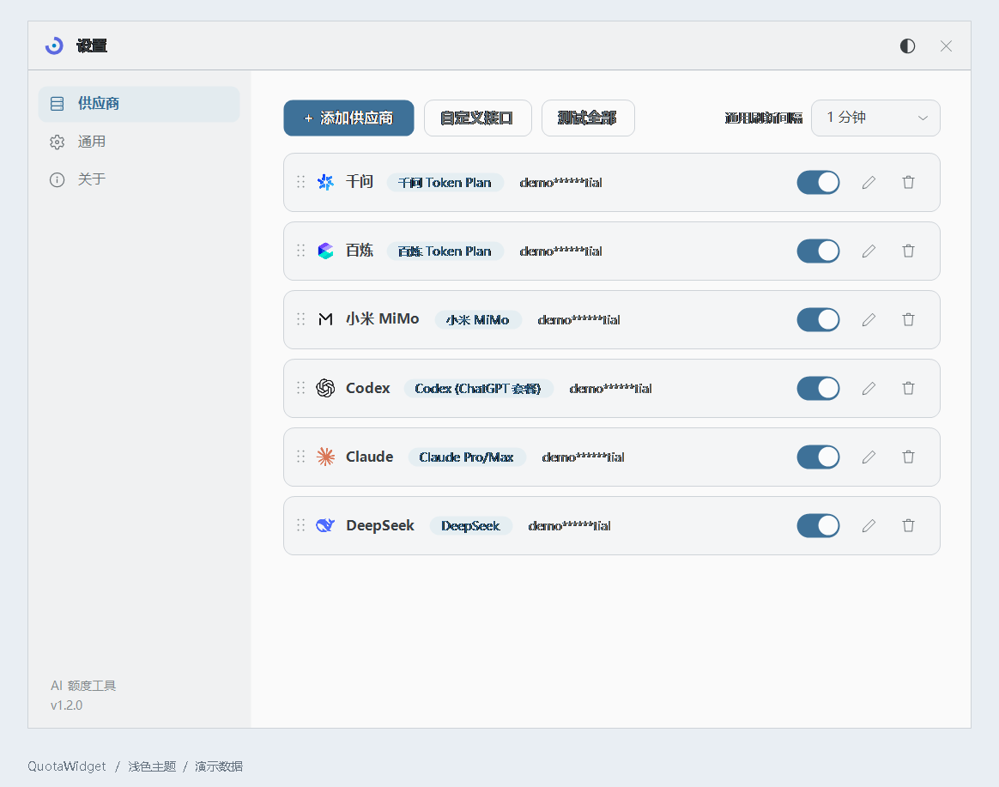
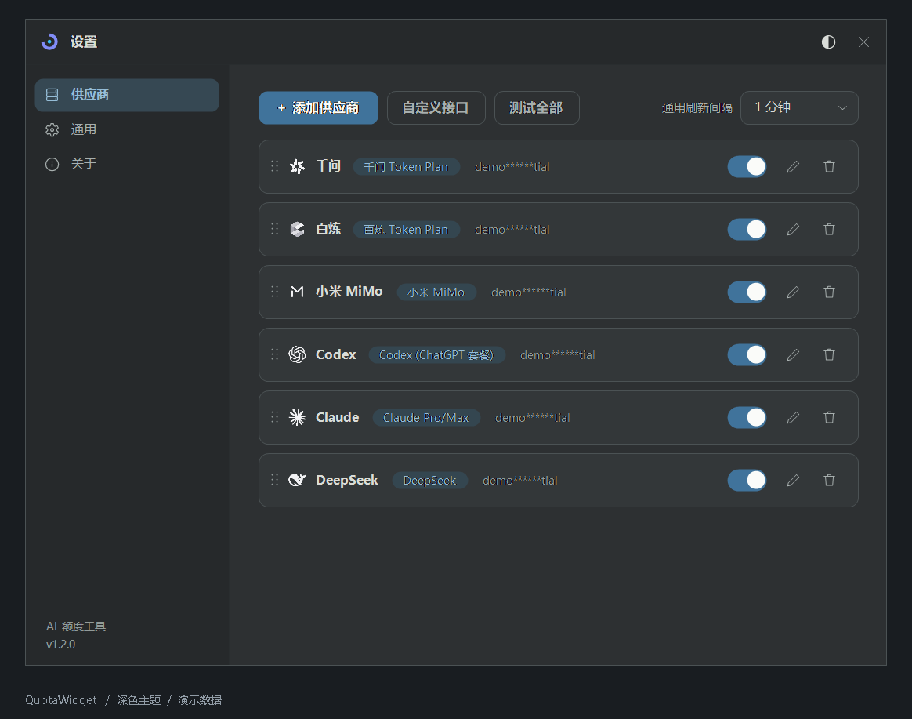

# 快速开始

[返回首页](../README.md) · [文档目录](README.md)

需要 Windows 与 .NET Framework 4.x。使用 Cookie「自动获取」时，还需要安装 Microsoft Edge 或 Google Chrome。

1. 从 [Gitee 发布页](https://gitee.com/dashingmonkey/quota-widget/releases/latest) 或 [GitHub 发布页](https://github.com/DashingMonkey/quota-widget/releases/latest) 下载 `QuotaWidget.exe`，双击运行，无需安装。
2. 首次启动后，悬浮窗位于主屏顶部中央。右键悬浮窗或系统托盘图标，打开 **设置 → 供应商 → ＋ 添加供应商**。
3. 选择服务商并填写相应凭证。API Key、控制台 Cookie 或本机登录凭证的区别见[供应商配置](providers/README.md)。点击 **确认** 后自动保存并开始查询。
4. 将鼠标移到悬浮窗上查看详细额度；在 **设置 → 通用** 中调整排列、置顶和透明度，使用设置窗口右上角的主题按钮切换明暗外观。

也可以下载源码后双击 `build.bat` 自行编译，无需安装 Visual Studio，详见[参与开发](development.md)。

## 常用操作

| 操作 | 效果 |
| --- | --- |
| 鼠标悬停悬浮窗 | 展开额度明细与重置倒计时 |
| 双击悬浮窗 | 立即刷新，仍遵守接口的限流与冷却时间 |
| 拖动悬浮窗 | 调整位置；条形模式可吸附顶部或左右侧边 |
| 单击托盘图标 | 临时展开已开启的吸附悬浮窗，方便定位 |
| 右键悬浮窗或托盘图标 | 打开设置、开启 / 关闭悬浮窗或退出程序 |
| 供应商列表中的开关 | 暂停该供应商的查询与展示，保留配置 |

## 外观与日常使用

- 在设置窗口右上角切换浅色 / 深色主题，品牌图标同步切换。
- 在「通用」页选择条形灵动岛或矩形卡片，调整透明度、始终置顶、固定位置与开机自启。
- 在「供应商」页拖拽调整顺序，使用开关暂停单个供应商。停用后保留配置，不再查询和展示。
- 通用刷新间隔默认为 60 秒，也可以在每条供应商中设置独立间隔。
- 设置自动保存；供应商和自定义接口编辑完成后点击「确认」。

## 界面示例

以下为使用模拟数据生成的实际界面。

| 浅色主题 | 深色主题 |
| --- | --- |
|  |  |

遇到问题可查看[常见问题](faq.md)，凭证存储方式见[数据与隐私](privacy.md)。
